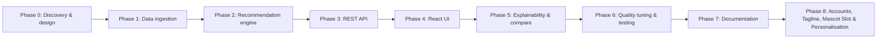

# 02 · Build Phases

| Phase | Goal | Deliverables | Status |
|---|---|---|---|
| **0 · Discovery** | Understand data, agree scope | Dataset inspection (271,360 rows, 8 cols, no ratings); decisions in [01-requirements.md](01-requirements.md) | ✅ Done |
| **1 · Data ingestion** | Get CSV into MongoDB | `server/src/models/Book.js`, `server/src/scripts/import.js` (streaming, batched 5k, dedupes ISBNs, cleans years), text index | ✅ Done — 271,359 books |
| **2 · Engine** | Fast in-memory recommender | `recommender/text.js` (tokeniser), `engine.js` (TF-IDF vectors, inverted index, author/publisher maps), `algorithms.js` (5 algorithms) | ✅ Done — index builds in ~8 s |
| **3 · API** | Expose search & recommend | `routes/api.js`: `/health`, `/algorithms`, `/books/search` (with pagination), `/books/:isbn`, `/recommend/:isbn` | ✅ Done |
| **4 · UI** | Usable front-end | Vite + React: search bar with instant autocomplete, **dedicated paginated search results page**, breadcrumbs, algorithm picker, result cards with covers | ✅ Done |
| **5 · Explainability** | Show *how* | Seed TF-IDF term weights, per-feature bars, formula + step list, live hybrid sliders, **Compare all** grid, candidate counts & timings | ✅ Done |
| **6 · Tuning & testing** | Better results | Collapse editions/formats/translations via "work key", HTML-entity decoding, format stop-words; smoke tests ([09-testing.md](09-testing.md)) | ✅ Done |
| **7 · Docs** | Everything documented | This `readme/` folder | ✅ Done |
| **8 · Accounts & Personalisation** | Goodreads-style recommendations, mascot slot & logout flow | User model (`User.js`), JWT auth, `AuthPage.jsx` with tagline & mascot slot, `LogoutPage.jsx`, `Onboarding.jsx`, `ForYou.jsx`, `Shelves.jsx`, `recommendProfile()`, 36 automated smoke checks | ✅ Done |

## Phase detail

### Phase 1 – Data ingestion
1. Stream the 73 MB CSV with `csv-parse` (never loads it fully into memory).
2. Clean each row (trim; year `0` or > 2025 → `null`).
3. Skip duplicate ISBNs / empty titles, `insertMany` in batches of 5,000.
4. Create indexes: unique `isbn`, text index on `title`+`author`, `author`.

### Phase 2 – Engine
At server start the engine streams all books from MongoDB and builds in-memory structures
(see [03-architecture.md](03-architecture.md)). Mongo stays the source of truth; the engine is a derived cache.

### Phase 3 – API
Thin Express layer; returns `503` until the index is ready so the UI can show "Building index…".
Supports paginated text search via `/api/books/search?q=&page=&limit=`.

### Phase 4/5 – UI, search flow & explainability
Single-page app with distinct interactive states:
1. **Landing state**: Search bar + popular sample topic pills (Hobbit, Harry Potter, Dune, Stephen King, etc.).
2. **Search results page**: Pressing Return or clicking "Search" renders a dedicated paginated grid of books matching the query, with cover images, authors, years, publishers, ISBNs, and a "Get Recommendations" CTA.
3. **Recommendation view**: Selecting a book displays its seed terms, algorithm selector, live weight sliders, "How it works" math explainer, and recommendation cards with individual feature bars. Breadcrumbs let users jump back to their active search results page anytime.

### Phase 6 – Tuning
Initial results were dominated by duplicates ("The Hobbit", "El Hobbit", "Hobbit (Audio CD)").
Fix: a *work key* = sorted tokens of the main title (parentheses and subtitles stripped) used to
de-duplicate results and to exclude other editions of the seed.

### Phase 8 – User Accounts, Tagline, Mascot Slot & Personalisation
1. **User Authentication:** Registered accounts stored in MongoDB with bcrypt hashing; stateless JWT session tokens stored in `localStorage`.
2. **Branding & Tagline:** Implemented the official brand tagline **“Bookable - Where wisdom meets technology”** across auth and logout pages.
3. **Mascot Slot (`.mascot-slot`):** Dedicated, responsive container reserved on login and logout views, ready for an upcoming mascot asset.
4. **Dedicated Logout Flow:** `LogoutPage.jsx` cleanly clears credentials, confirms session end, and provides an immediate one-click button to return to the Login page.
5. **Goodreads-Inspired Onboarding:** Users select 3–5 favorite books from a curated popular grid or search.
6. **Multi-Seed Profile Recommendations:** Runs each of the five algorithms across all user favorites, computes average scores, applies greedy diversity re-ranking, and displays per-favorite contribution bars.
7. **Shelves:** Favorites and Want to Read shelves with toggle controls.

