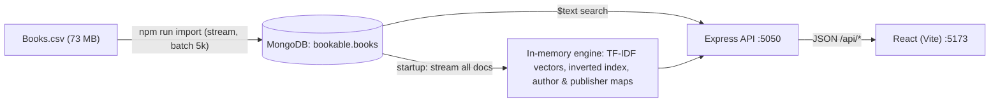
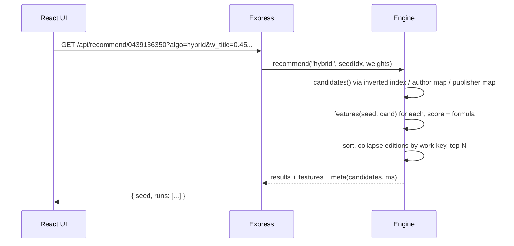

# 03 · Architecture



## Why an in-memory engine?
- Similarity needs to compare a seed against many books; doing that in MongoDB per request is slow.
- 271k short titles fit comfortably in memory (~66k-term vocabulary); index builds in ~8 s.
- MongoDB remains the system of record (and powers text search); the engine is rebuilt on boot.

## Request flow – `GET /api/recommend/:isbn?algo=hybrid`


## Folder layout
```
Bookable/
├── Books.csv
├── readme/                 ← all documentation
├── server/
│   └── src/
│       ├── index.js        ← Express bootstrap, triggers index build
│       ├── db.js           ← Mongo connection (MONGO_URI)
│       ├── models/Book.js
│       ├── scripts/import.js
│       ├── routes/api.js
│       └── recommender/
│           ├── text.js       ← normalise, tokenise, stem, decode
│           ├── engine.js     ← index building, cosine, neighbours
│           └── algorithms.js ← 5 algorithms + recommend()
└── client/
    ├── vite.config.js      ← proxies /api → :5050
    └── src/
        ├── App.jsx, api.js, styles.css
        └── components/ SearchBar, Cover, SeedPanel, AlgorithmPicker,
                         WeightSliders, HowItWorks, ResultsRun
```

## Key design pattern
Every algorithm is defined as **candidate generation + scoring formula** over a **shared feature
vector** `{title, author, publisher, year}` (all in [0,1]). This makes algorithms directly
comparable and lets the UI show the same breakdown for every result.
