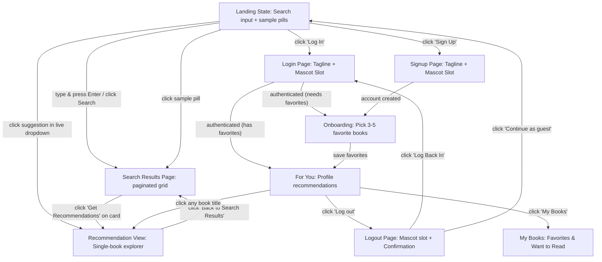

# 07 · Frontend

Vite + React 19, plain CSS (`client/src/styles.css`), no UI component libraries.

## UX Flow & Navigation Architecture

---

## App Views & Interactive States

### 1. Landing Screen (Public Guest View)
- Prominent search input with search icon, clear button (`✕`), and "Search" button.
- Clickable suggestion pills (`“Hobbit”`, `“Harry Potter”`, `“Stephen King”`, `“Dune”`, `“Tolkien”`, etc.) for instant one-click searching.
- Live autocomplete dropdown appears as user types for quick direct selection.
- Call-to-action banner inviting guests to create an account for personalized multi-book recommendations.

### 2. Login & Sign Up Pages (`AuthPage.jsx`)
- **Brand Tagline:** Prominently displays the official motto:  
  **“Bookable - Where wisdom meets technology”**
- **Designated Mascot Slot (`.mascot-slot`):** Dedicated styled container with centered dimensions (`130px × 110px`), dashed border, rounded corners, and a visual placeholder badge, engineered so any SVG, 3D character, or image can be dropped in.
- **Form Controls:** Clean input fields for username and password (plus optional display name for signup).
- **Mode Toggle:** Seamless switching between "Log in" and "Create an account".
- **Guest Option:** "← Continue browsing as guest" returns directly to public exploration.

### 3. Dedicated Logout Page (`LogoutPage.jsx`)
- Triggered when the user clicks **“Log out”** in the navigation bar.
- Clears stored auth tokens from `localStorage` and resets session state.
- Features the mascot slot and the brand tagline **“Bookable - Where wisdom meets technology”**.
- Shows a friendly confirmation: *"You have been logged out. Thank you for visiting Bookable. Your session has safely ended."*
- Prominent primary button: **“Log Back In →”** navigating directly back to the login page.
- Secondary option: **“← Continue browsing as guest”** to browse the public explorer.

### 4. Goodreads-Inspired Onboarding (`Onboarding.jsx`)
- Interactive step required after signup or when editing favorites.
- Users pick 3–5 books they love using either the search bar or the curated 28-book **Popular on Bookable** grid.
- Visual selection counter (`3 / 5 selected`), book chips with remove buttons (`✕`), and checkmark badge overlays.
- Requires at least 3 books before proceeding to generate profile recommendations.

### 5. Personalised "For You" Page (`ForYou.jsx`)
- Greets the user: *"Recommended for {DisplayName}"*.
- **Favorites Strip:** Displays the user's seed books with an "Edit" button to adjust favorites at any time.
- **Algorithm Switcher & Compare All:** Explore how all 5 algorithms interpret the user's multi-book taste profile.
- **Explainability:** Each recommended card explains *"Because you liked {Title 1}, {Title 2}"* and provides per-seed score contribution bars.
- **Want to Read Shelf Action:** "+ Want to Read" button lets users save recommendations to their personal reading list with one click.

### 6. My Books Shelves (`Shelves.jsx`)
- Displays the user's **Favorites** (the seeds powering their recommendations).
- Displays the **Want to Read** shelf with book covers and one-click removal.

### 7. Dedicated Search Results Page (`SearchResults.jsx`)
- Triggered by pressing <kbd>Enter</kbd> or clicking "Search".
- Responsive book card grid with covers, titles, authors, publishers, years, ISBN tags, and "✨ Get Recommendations →" action buttons.
- Full server-backed pagination (24 books per page) with Previous and Next controls.

### 8. Single-Book Recommendation View
- Breadcrumbs for easy navigation back to Search Results or the "For You" page.
- Explains single-book TF-IDF terms, formula, candidate counts, and feature breakdown bars.

---

## Component Hierarchy & Directory
| Component | File Path | Role |
|---|---|---|
| `App.jsx` | `client/src/App.jsx` | Top-level state coordinator: view routing (`home`, `search`, `explore`, `login`, `signup`, `logout`, `onboarding`, `foryou`, `shelves`), session management, and navigation |
| `AuthPage.jsx` | `client/src/components/AuthPage.jsx` | Login and Signup forms featuring the tagline *"Bookable - Where wisdom meets technology"* and the reserved Mascot Slot |
| `LogoutPage.jsx` | `client/src/components/LogoutPage.jsx` | Dedicated logout confirmation screen with mascot slot, tagline, and direct "Log Back In" button |
| `Onboarding.jsx` | `client/src/components/Onboarding.jsx` | Goodreads-style 3–5 book selector with search and popular books grid |
| `ForYou.jsx` | `client/src/components/ForYou.jsx` | Personalized recommendation dashboard aggregated across favorite seeds with per-favorite contribution bars |
| `Shelves.jsx` | `client/src/components/Shelves.jsx` | Displays user's Favorites and Want to Read reading lists |
| `SearchBar.jsx` | `client/src/components/SearchBar.jsx` | Form input handling Return key submits, search button, clear button, and debounced autocomplete dropdown |
| `SearchResults.jsx` | `client/src/components/SearchResults.jsx` | Dedicated search results page with book card grid, metadata, and pagination controls |
| `Cover.jsx` | `client/src/components/Cover.jsx` | Book cover image loader with fallback to letter initials for missing or 1×1 placeholder images |
| `SeedPanel.jsx` | `client/src/components/SeedPanel.jsx` | Displays current seed book details and extracted TF-IDF title term weights |
| `AlgorithmPicker.jsx` | `client/src/components/AlgorithmPicker.jsx` | Switcher tabs for the 5 algorithms plus the side-by-side **Compare all** view |
| `WeightSliders.jsx` | `client/src/components/WeightSliders.jsx` | Interactive range sliders for tuning hybrid weights live |
| `HowItWorks.jsx` | `client/src/components/HowItWorks.jsx` | Mathematical formula, rationale, and explainability breakdown for the active algorithm |
| `ResultsRun.jsx` | `client/src/components/ResultsRun.jsx` | Renders recommendations with candidate count, latency in ms, score bars, and feature breakdown bars |

