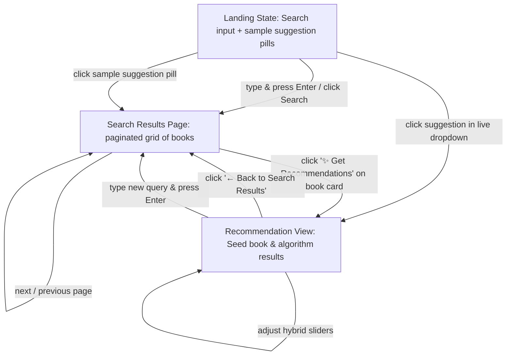

# 07 · Frontend

Vite + React 19, plain CSS (`client/src/styles.css`), no UI component libraries.

## UX Flow & Navigation Architecture

## Three Main App States

### 1. Landing Screen (Empty / Initial State)
- Prominent search input with search icon, clear button (`✕`), and "Search" button.
- Clickable suggestion pills (`“Hobbit”`, `“Harry Potter”`, `“Stephen King”`, `“Dune”`, `“Tolkien”`, etc.) for instant one-click searching.
- Live autocomplete dropdown appears as user types for quick direct selection.

### 2. Dedicated Search Results Page (`SearchResults.jsx`)
- Triggered when the user:
  - Types in the search bar and **hits Return / Enter**.
  - Clicks the **Search** button.
  - Clicks the **“View all search results for ‘...’”** footer in the autocomplete dropdown.
  - Clicks a sample search pill.
- **Header:** Displays query highlight, total count badge (`Found X books`), and a clear search button.
- **Responsive Card Grid:**
  - Book cover with automatic missing-image fallback.
  - Book title (truncated cleanly to 2 lines max).
  - Author, publication year, and publisher.
  - Monospace ISBN tag.
  - Clear **“✨ Get Recommendations →”** call-to-action button.
- **Pagination Controls:** Previous and Next buttons with active `Page X of Y` indicator (24 books per page).
- **Empty State:** Helpful tips (check spelling, search by author or keyword) when no books match.

### 3. Recommendation View
- **Breadcrumb Navigation:** Displays `← Back to Search Results for “{query}”` so users can return to the search list without retyping.
- **Sidebar (Aside):**
  - **Seed Book Panel:** Cover, full title, author, year, publisher, ISBN, and its **TF-IDF title terms** (reveals what the content algorithm extracted).
  - **Hybrid Weight Sliders:** Real-time sliders for Title, Author, Publisher, and Year percentages (active in Hybrid and Compare modes).
  - **“How It Works” Panel:** Formula, overview, and step-by-step description for the currently active algorithm.
- **Main Area:**
  - Algorithm selector tabs (`TF-IDF`, `Same Author`, `Same Publisher & Era`, `Era + Theme`, `Weighted Hybrid`, and `⚖️ Compare all`).
  - Result cards with rank, cover, title, author, year, final score bar, and per-feature breakdown bars (`Title`, `Author`, `Publisher`, `Year`).
  - Interactive exploration: clicking any recommended book immediately makes it the new seed.

---

## Component Hierarchy & Directory
| Component | File Path | Role |
|---|---|---|
| `App.jsx` | `client/src/App.jsx` | Top-level state coordinator: manages view mode (landing / search results / recommendation), active seed, algorithm, weights, and health status |
| `SearchBar.jsx` | `client/src/components/SearchBar.jsx` | Form input handling Return key submits, search button, clear button, and debounced autocomplete dropdown |
| `SearchResults.jsx` | `client/src/components/SearchResults.jsx` | Dedicated search results page with book card grid, metadata, and pagination controls |
| `Cover.jsx` | `client/src/components/Cover.jsx` | Book cover image loader with fallback to letter initials for missing or 1×1 placeholder images |
| `SeedPanel.jsx` | `client/src/components/SeedPanel.jsx` | Displays current seed book details and extracted TF-IDF title term weights |
| `AlgorithmPicker.jsx` | `client/src/components/AlgorithmPicker.jsx` | Switcher tabs for the 5 algorithms plus the side-by-side **Compare all** view |
| `WeightSliders.jsx` | `client/src/components/WeightSliders.jsx` | Interactive range sliders for tuning hybrid weights live |
| `HowItWorks.jsx` | `client/src/components/HowItWorks.jsx` | Mathematical formula, rationale, and explainability breakdown for the active algorithm |
| `ResultsRun.jsx` | `client/src/components/ResultsRun.jsx` | Renders recommendations with candidate count, latency in ms, score bars, and feature breakdown bars |

