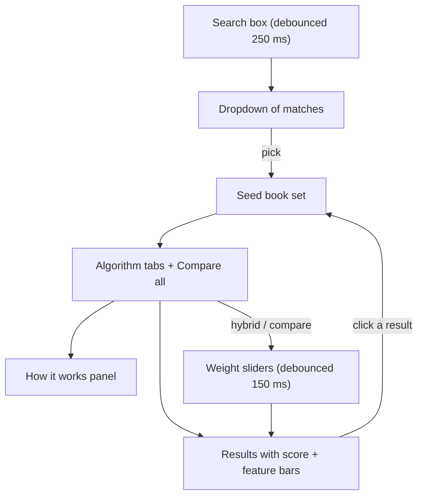

# 07 · Frontend

Vite + React 19, plain CSS (`client/src/styles.css`), no UI library.

## UX flow

## Components
| Component | Role |
|---|---|
| `App.jsx` | State (seed, algo, weights), fetches recommendations, polls `/health` until index ready |
| `SearchBar.jsx` | Autocomplete search against `/api/books/search` |
| `Cover.jsx` | Cover image; falls back to a letter placeholder for missing / 1×1 Amazon images |
| `SeedPanel.jsx` | Seed details + its **TF-IDF term weights** (shows what the title algorithm "sees") |
| `AlgorithmPicker.jsx` | Tabs for the 5 algorithms + **⚖️ Compare all** |
| `WeightSliders.jsx` | Live hybrid weights, shown as normalised percentages |
| `HowItWorks.jsx` | Description, formula and step-by-step explanation of the selected algorithm |
| `ResultsRun.jsx` | One algorithm's results: rank, cover, score bar, feature bars, candidate count & ms |

## Explainability features
- Final score bar + four feature bars per result (detailed view).
- Formula and candidate count/latency for every run.
- Compare mode puts all five algorithms side-by-side for the same seed.
- Click-through: any result becomes the new seed.
